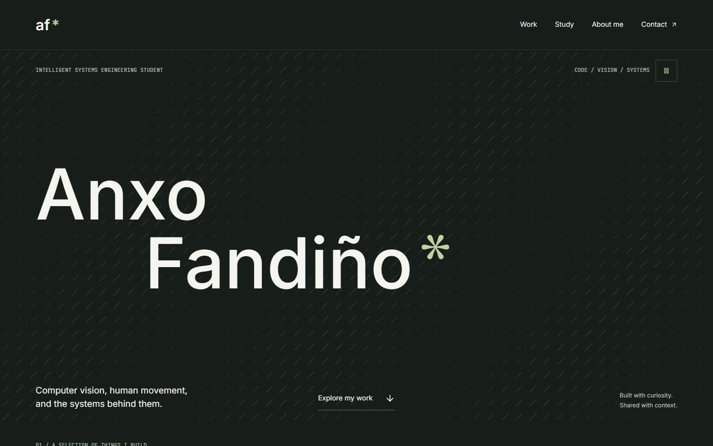
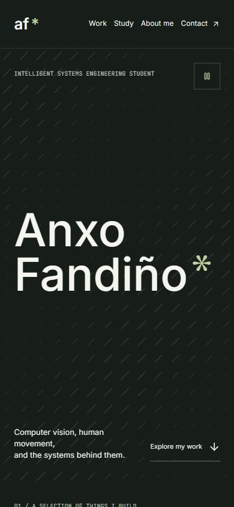
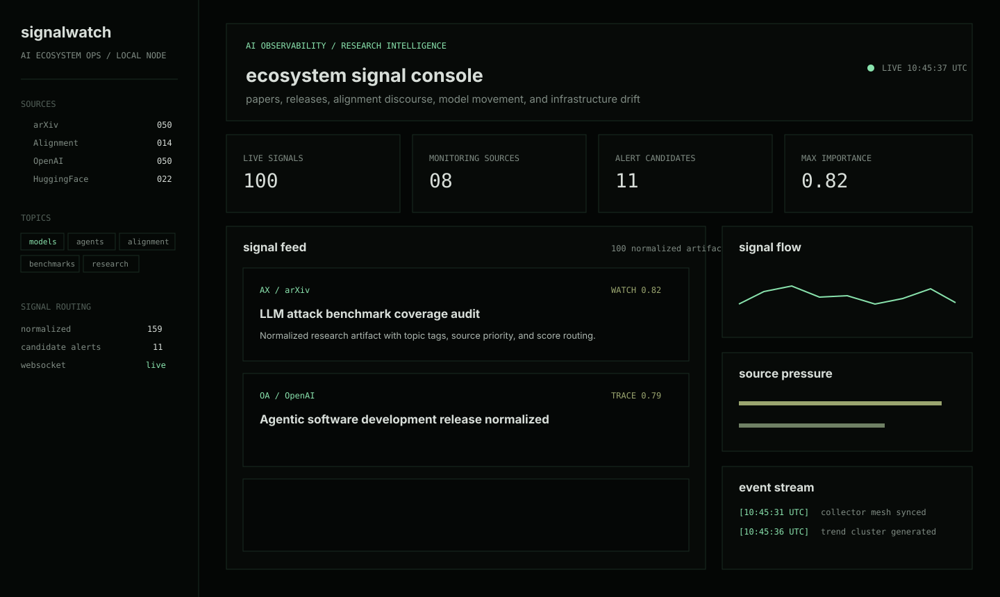
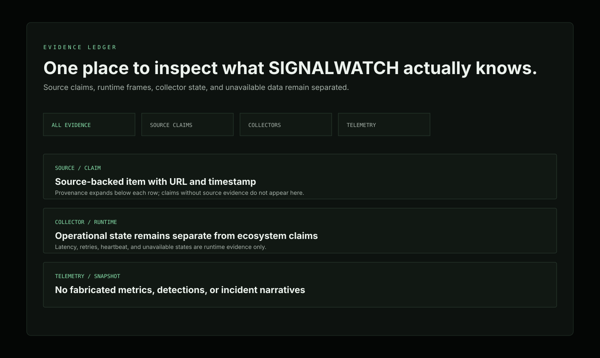

# Anxo Fandiño — Portfolio

Personal portfolio for Anxo Fandiño, built with Next.js and TypeScript. Project domain: [jgsops.dev](https://jgsops.dev). All portfolio copy is in English.

Selected projects:

- [Squat Judge](https://github.com/jgs/Squat-Judge): final project exploring pose estimation, joint angles, and squat sequence analysis.
- [BarPath AI](https://github.com/jgs/barpath-ai): barbell trajectory analysis and annotated training footage.
- [SIGNALWATCH](https://github.com/jgs/signalwatch): source monitoring, evidence inspection, and perception robustness.

Portfolio routes: `/`, `/about`, and `/work/[slug]`. The original SIGNALWATCH entry is preserved at `/signalwatch`, with its project background at `/signalwatch/about`. Existing operational routes remain available.

Project descriptions follow the repositories' documentation. BarPath shows a still from its recorded repository demo and plays the recording on request. The Squat Judge feature includes an educational anatomy study for squat, deadlift, and bench press, with linked NASM sources. These qualitative muscle highlights are not model outputs or measured activation. Infrastructure artwork is labeled as generated context. No results or performance figures are invented.

The portfolio uses an editorial project gallery with larger previews, project context before the media, and direct links to each case study and source repository. Sticky navigation keeps Work, Study, About me and Contact accessible. The "A closer look" section distinguishes the educational movement study from the model-dependent perception lab. The original anatomy illustration and its interactions are unchanged.

The green opening fills the initial view, with a small preview of the next chapter. Section links use native smooth scrolling, without replacing wheel or touch behavior. Reduced-motion preferences disable the background animation and smooth scrolling. The background also has a pause control and stops animating outside the viewport or when the tab is hidden. The project directory links directly to each case, and the contact area copies the public email address without opening an email application.

Case pages show one documented workflow for each movement project and a separate component overview for SIGNALWATCH; its independent surfaces are not presented as a sequential data pipeline. These diagrams describe project structure, not live inference or measured results.

Anatomy rendering uses `js-rich-body-highlighter` (MIT). Its asset license and source notes are retained in `frontend/public/portfolio/anatomy/LICENSE` and `frontend/public/portfolio/media.json`. The study is contained in `MovementStudy` and can be removed without changing the project data or inference modules.

## Local Development

From `frontend`, run `npm ci` and `npm run dev`. Portfolio pages do not require the backend; SIGNALWATCH live surfaces require the backend configuration described below.

Frontend checks: `npm run typecheck` and `npm run build`. Type checking generates Next.js route definitions first, including on a clean checkout. Backend checks, from `backend`: `python -m pytest` and `python -m compileall app`.

Dependency maintenance: Next.js and its ESLint configuration are pinned to `15.5.29`. The scoped PostCSS override keeps Next.js on the same patched `8.5.32` release as the build toolchain. TypeScript ESLint tools are pinned together to preserve ESLint 9 compatibility. The production audit is clear as of November 12, 2026. The full audit still reports six moderate entries from one [Minimatch advisory](https://github.com/advisories/GHSA-g3hv-75wg-m249) in the development-only TypeScript ESLint dependency chain; its fix requires a major dependency change. Do not run lint against untrusted glob patterns, and recheck both audits before deployment. An audit is not a guarantee that the application is vulnerability-free.

## You're the Input

The `/input` experiment is linked from the portfolio's "A closer look" section. Mouse and keyboard controls expose the same three projects as camera mode. Camera input uses [MediaPipe Hands with the TensorFlow.js runtime](https://github.com/tensorflow/tfjs-models/tree/master/hand-pose-detection/src/tfjs), loaded only after selecting that mode. Its returned hand landmarks drive the controls without requiring visible shoulders or an elevated wrist. Video and landmark estimates remain in browser memory: the experiment does not record, store, or upload them. Model files are fetched from TensorFlow Hub; ordinary site analytics are separate from camera data.

Changing mode, stopping the camera, leaving the route, hiding the tab, or moving the experiment out of view releases the video tracks. A cancelled permission request cannot revive a stopped session. Missing or stale landmarks do not produce replacement skeletons or gesture commands. Qualitative gesture thresholds control the interface only; they are not calibrated measurements or exercise assessments.

Run `npm run test:input` from `frontend` for deterministic control tests. Their synthetic landmark fixtures are unit-test inputs, never runtime telemetry. Local browser checks confirmed live MediaPipe Hands inference, video display, and camera shutdown when switching to mouse. Camera mode includes an independent mirrored video preview so missing landmarks do not hide the camera input. No per-landmark confidence values are invented from the model's hand-level output. Gesture responsiveness depends on the camera, lighting, device, and browser.

A CPU smoke check with TensorFlow's official [hands.jpg fixture](https://raw.githubusercontent.com/tensorflow/tfjs-models/master/hand-pose-detection/test_data/hands.jpg) returned two hands with 21 finite landmarks each. This is a functional check on that input, not a benchmark or proof of webcam accuracy.

Camera frames are copied into an in-memory canvas before inference. The camera selector identifies the actual video source; compatibility mode uses the CPU and the lightweight hand model. The input dimensions, backend, and last observed inference duration are diagnostics from the current session, not benchmark claims. Gesture holds require at least three agreeing samples; explicit missing-hand results or gaps over 1.2 seconds reset the hold. Results taking more than 1.2 seconds cannot trigger gestures, and the interface reports slow tracking instead of implying that controls are responsive. Buttons remain available. The overlay exposes its actual landmark draw count as a DOM diagnostic without retaining coordinates or images. Input buffers are cleared after pending inference finishes when a session stops.

The local navigation prototype filters only its control signal, not the model landmarks. Project boundaries use hysteresis, with a shorter selection hold. A mirrored palm cursor activates explicitly marked controls after a 650 ms dwell, once per hover. Upper/lower edge zones scroll the project story or the open dialog, stopping on neutral, missing, hidden, or stale input. The cursor is moved into the dialog's top layer while details are open. The project story reuses the portfolio's source-backed project data. Full project pages and external links end the camera experiment; gestures do not continue across the whole public portfolio.

The WebGL loop schedules its next inference with [requestVideoFrameCallback](https://developer.mozilla.org/en-US/docs/Web/API/HTMLVideoElement/requestVideoFrameCallback) where available, so work follows new video frames instead of adding a fixed delay. Older browsers retain a cancellable 16 ms timer fallback, and CPU mode keeps its yielding delay. Only one inference runs at a time. Overlay drawing skips unchanged inputs and batches strokes; cursor movement uses a compositor transform, with hit testing before style writes. Full-frame blank checks and diagnostic updates are limited to once per second. These are workload and scheduling changes, not a measured frame-rate or accuracy claim; the model and capture dimensions are unchanged.

Two-hand commands are also local experiments. Pinching thumb and index finger on both hands establishes a scale baseline; changing their horizontal separation adjusts content scale between 85% and 135%. Camera video, hand landmarks, the cursor, and browser chrome are not magnified. A separate hands-together gesture, outside a two-hand pinch, opens the optional Signal Trail mini game, with a cooldown. It calibrates to a brief stable initial spacing (three samples over at least 160 ms), then unlocks on an observed relative contraction. No reopening step is required. It no longer requires hands to span a fixed fraction of the camera image. A small live badge indicates when the gesture is armed. This recognizes a clap-like visual motion, not audio or physical contact. Armed sequence memory can pause for up to 500 ms after the last observed two-hand frame, but missing outputs never advance it or generate replacement positions. An actual observed two-hand contraction is mandatory. Slow inference, invalid input, and longer losses reset it. The current phase is exposed on the status element for local diagnostics, not stored. These commands replace the original two-hands-apart project-opening gesture; project buttons remain available through the hand cursor. Both commands are disabled inside the game and privacy dialog.

Signal Trail is an original nine-target pointing game, not a benchmark or a perception evaluation. Targets, paths, and collected counts are game state; only actual pointer/button activations advance the round. Camera targets use a 140 ms dwell and still require three agreeing inference samples. Mouse and keyboard use the same targets. Normal zoom buttons and the gamepad button provide camera-free access. No microphone, recording, or additional model is used. Physical gesture recognition still needs user testing on different cameras and lighting conditions.

## Portfolio Preview

Actual browser captures of the portfolio, including its mobile layout:





[Full desktop page](assets/screenshots/portfolio-refined-1440.jpg) / [Full mobile page](assets/screenshots/portfolio-refined-390.jpg) / [Project gallery](assets/screenshots/portfolio-refined-gallery.jpg)

## SIGNALWATCH Project Documentation

The sections below describe the embedded SIGNALWATCH project rather than the portfolio as a whole.

<p align="center">
  
</p>

<h1 align="center">SIGNALWATCH</h1>

<p align="center">
  Evidence-aware AI observability for source-backed signals, runtime telemetry, and perception robustness.
</p>

<p align="center">
  <a href="https://jgsops.dev">jgsops.dev</a>
  <span>&nbsp;&nbsp;/&nbsp;&nbsp;</span>
  <a href="https://jgsops.dev/about">about</a>
  <span>&nbsp;&nbsp;/&nbsp;&nbsp;</span>
  <a href="https://jgsops.dev/console">console</a>
  <span>&nbsp;&nbsp;/&nbsp;&nbsp;</span>
  <a href="https://jgsops.dev/evidence">evidence ledger</a>
  <span>&nbsp;&nbsp;/&nbsp;&nbsp;</span>
  <a href="https://jgsops.dev/labs/perception">safety-critical perception</a>
  <span>&nbsp;&nbsp;/&nbsp;&nbsp;</span>
  <a href="https://jgsops.dev/methodology">methodology</a>
</p>

<p align="center">
  
  
  
  
  
  
</p>

---

## Overview

SIGNALWATCH is a public AI safety and observability platform built around evidence boundaries rather than feeds, hype, or generic dashboards.

It monitors AI ecosystem movement, alignment and governance signals, source-backed safety frameworks, realtime telemetry, and browser-side computer vision robustness. The interface is dark, calm, and infrastructure-oriented: a quiet operational surface for inspecting what was observed, where it came from, and what remains unknown.

Core surfaces:

- realtime ecosystem observability console
- evidence ledger for source claims, telemetry frames, and collector state
- source-backed AI safety intelligence layer
- safety-critical perception lab with browser-side COCO-SSD inference
- operational timeline and daily briefing layer
- systems/operator identity surface
- methodology boundary for real, derived, simulated, and conceptual data

Recommended public path:

```text
/start -> /console -> /evidence -> /labs/perception
```

The `/signalwatch/about` page explains what SIGNALWATCH is, what it is not, and which surfaces contain source data, runtime telemetry, browser-side model outputs, or conceptual education.

## Operational Principle

SIGNALWATCH is designed to feel alive without fabricating intelligence.

```text
real source activity        -> ecosystem signals
aggregated source movement  -> derived operational intelligence
browser model outputs       -> CV confidence and detection telemetry
runtime behavior            -> infrastructure telemetry
educational mechanisms      -> clearly labeled conceptual simulations
```

Missing data remains visible. Unavailable models remain unavailable. Conceptual demos are labeled. Confidence values are shown only when a real model emits them.

SIGNALWATCH does not fabricate:

- telemetry
- detections
- confidence values
- incidents
- source claims
- evaluation metrics

## Realtime Infrastructure

```text
AI ecosystem sources
        |
        v
collector mesh
        |
        v
normalization layer
        |
        v
semantic aggregation
        |
        v
historical memory
        |
        v
telemetry runtime
        |
        v
WebSocket event bus
        |
        v
operational console
```

Runtime behavior:

- async FastAPI service on Railway
- WebSocket event streaming over `/ws/events`
- rolling telemetry state
- real-data-derived signal generation
- collector health snapshots
- source latency and heartbeat telemetry
- frontend reconnect handling
- persistent timeline and briefing layer

Public routes:

```text
Frontend    https://jgsops.dev
Console     https://jgsops.dev/console
About       https://jgsops.dev/about
Evidence    https://jgsops.dev/evidence
Safety      https://jgsops.dev/safety
Perception  https://jgsops.dev/labs/perception
Methodology https://jgsops.dev/methodology
```

## Safety Intelligence

The safety layer translates credible AI safety material into a public operational interface.

Included systems:

- alignment concepts
- frontier risk categories
- governance and responsible scaling frameworks
- job displacement and task exposure explanations
- unaligned AI risk mechanisms
- source registry with reliability metadata

Initial registry includes:

- OpenAI Preparedness Framework
- Anthropic Responsible Scaling Policy
- OECD AI and Work
- Stanford AI Index 2025

The safety layer avoids doomposting, fake incidents, and unsourced statistics. Claim-heavy content must be source-backed or explicitly framed as conceptual explanation.

## Safety-Critical Perception

SIGNALWATCH Labs includes a dedicated operational robustness environment for AI vision systems.

```text
webcam or upload
        |
        v
canvas degradation pipeline
        |
        v
browser-side COCO-SSD inference
        |
        v
rolling detection history
        |
        v
confidence / persistence / temporal telemetry
```

Perception telemetry:

- `DETECTION.RELIABILITY`
- `CONFIDENCE.VARIANCE`
- `TRACKING.PERSISTENCE`
- `TEMPORAL.CONSISTENCY`
- `PERCEPTION.STABILITY`
- `FRAME.INTEGRITY`
- `OCCLUSION.PRESSURE`

Degradation modes:

- blur
- low light
- occlusion
- noise and compression artifacts
- crop instability
- motion blur
- environmental presets

The lab is not an AI magic demo. It is a small observability environment for inspecting how perception systems behave when real-world input quality changes.

## Methodology Boundary

SIGNALWATCH separates its information surfaces:

| Layer | Boundary |
| --- | --- |
| Real ecosystem data | Source-backed papers, releases, policy updates, safety posts, discourse, and model activity |
| Derived intelligence | Computed from aggregation, frequency, confidence, persistence, and temporal movement |
| Operational telemetry | Runtime state such as latency, reconnects, heartbeat, collector health, and infrastructure pressure |
| Browser CV | COCO-SSD detections and confidence emitted locally in the browser |
| Conceptual demos | Explicitly labeled simulations for alignment, oversight, and proxy-objective explanation |

This boundary is part of the product. It keeps the system credible while preserving the feeling of a live operational surface.

## Architecture

```text
                                    JGSOPS / SIGNALWATCH

     +----------------------+        +----------------------+        +----------------------+
     |  ecosystem sources   |        |  FastAPI runtime     |        |  Next.js interface   |
     |----------------------|        |----------------------|        |----------------------|
     |  research streams    | -----> |  asyncio collectors  | -----> |  console             |
     |  alignment discourse |        |  normalization       |        |  safety layer        |
     |  release movement    |        |  signal memory       |        |  perception lab      |
     |  policy updates      |        |  websocket manager   |        |  timeline            |
     +----------------------+        +----------------------+        +----------------------+
                                                |
                                                v
                                      +----------------------+
                                      | PostgreSQL-ready     |
                                      |----------------------|
                                      | operational events   |
                                      | collector snapshots  |
                                      | signal memory        |
                                      +----------------------+
```

## Stack

Frontend:

```text
Next.js 15
TypeScript
TailwindCSS
Framer Motion
Recharts
TensorFlow.js / COCO-SSD
```

Backend:

```text
FastAPI
asyncio
WebSockets
SQLAlchemy
PostgreSQL-ready storage
```

Infrastructure:

```text
Vercel frontend
Railway backend
Docker containerization
custom domain at jgsops.dev
```

## Visual Showcase

Repository visuals:

```text
assets/screenshots/dashboard.svg
assets/screenshots/evidence-ledger.svg
```

### Operational Console

Realtime telemetry, collector health, semantic topology, live event stream, and WebSocket state.

<p align="center">
  
</p>

### Evidence Ledger

Claims, telemetry, collector health, and unavailable states are kept separate.

<p align="center">
  
</p>

### Safety-Critical Perception

Browser-side CV inference under controlled degradation. Confidence, persistence, and temporal telemetry come only from model outputs.

Use `/labs/perception` for the live browser-side lab.

### Safety Intelligence

Source-backed public AI safety explanations with evidence chains and reliability metadata.

Use `/safety` for the live source-backed safety layer.

### Timeline Memory

Operational history, signal evolution, and daily intelligence briefing.

Use `/timeline` for the live operational timeline.

## Design Philosophy

SIGNALWATCH follows an observability-first design language.

The interface should feel like quiet mission control: dark surfaces, thin borders, precise typography, dense data, restrained motion, and small operational pulses. It should be understandable to non-experts without flattening the engineering identity.

Avoided deliberately:

- cyberpunk overload
- startup SaaS language
- fake AI telemetry
- unsourced statistics
- news-feed design
- chatbot wrapper aesthetics
- flashy ML playgrounds

## Deployment

Production:

```text
domain      https://jgsops.dev
frontend    Vercel
backend     Railway
```

Environment:

```env
NEXT_PUBLIC_API_URL=<your-public-backend-url>
NEXT_PUBLIC_WS_URL=<your-public-websocket-url>/ws/events
SIGNALWATCH_CORS_ORIGINS=<your-public-frontend-origin>,http://localhost:3000,http://127.0.0.1:3000
```

## Repository Structure

```text
signalwatch/
  frontend/       Next.js operational interface
  backend/        FastAPI realtime runtime
  docker/         container definitions
  assets/         screenshots, demos, diagrams
```

## Closing

Monitoring the operational surface of intelligent infrastructure.
